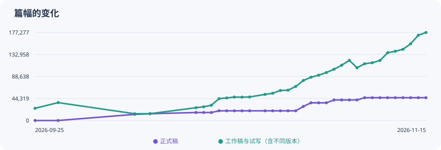

# 小说生长记录

写嗨了可能会失联，但故事还在慢慢长大。这里是自动更新的写作进度。

**最近统计：2026-11-15 22:28（北京时间）** · 通常每天 14:00 / 21:00 更新 · [下载当前正式稿 TXT](https://github.com/JizhiShiroppu/novel-progress/releases/tag/latest-formal)

> 统计更新时间表示程序完成同步，不代表作者当时在线。

## 核心数据与近期节奏

| 内容 | 当前字数 | 纳入篇数 | 今日净变化 | 近七天净变化 | 近七天日均 | 此前总日均（排除近七天） |
| :--- | ---: | ---: | ---: | ---: | ---: | ---: |
| 正式稿 | **45,941** | 7 | +0 | +0 | +0.0 | +1,044.1 |
| 作者工作稿 | **53,475** | 10 | +2,028 | +17,659 | +2,522.7 | +552.5 |
| 大纲 | **114,258** | 16 | +701 | +35,936 | +5,133.7 | -1,210.9 |
| 设定 | **751,981** | 76 | +1,028 | +13,202 | +1,886.0 | +16,770.1 |
| Agent 参考与记录 | **172,718** | 22 | +52,397 | +92,211 | +13,173.0 | +1,533.4 |

工作稿目录已拆分为「作者工作稿」与「Agent 参考与记录」：上方曲线、近 14 日净变化、章节双轨进度条与活跃日历均只统计正式稿和作者工作稿，Agent 编写的多版试写、人称转换底稿、章总结与讨论记录单独列示，不虚高计入作者正文字数。

近 52 个自然日中共有 34 个记录快照日，其中 32 天有作者正文变动（当前连续 22 天 / 最长连续 22 天）。日均单位为字/天，未增字日期计入；历史不足时不估算。

## 趋势与活跃日历

## 章节推进与多稿打磨

正式稿与作者工作稿均计为作者本人编写的文本；同一章定稿后工作稿不重复相加，当前作者净正文规模（已定稿正式稿 + 未定稿作者工作稿）为 **65,639** 字。右侧 Agent 参考与记录另计。

展开章节篇幅数字明细（共 11 篇）

| 章节编号 | 正式稿字数 | 作者工作稿字数 | 作者稿份数 | Agent 参考与记录 | Agent 稿份数 |
| :--- | ---: | ---: | ---: | ---: | ---: |
| 第1卷 · 序章 | 666 | 0 | 0 | 0 | 0 |
| 第1卷 · 第1章 | 10,728 | 0 | 0 | 22,422 | 2 |
| 第1卷 · 第2章 | 8,116 | 8,118 | 1 | 22,232 | 4 |
| 第1卷 · 第3章 | 9,043 | 8,831 | 1 | 41,309 | 4 |
| 第1卷 · 第4章 | 7,893 | 7,333 | 1 | 18,610 | 2 |
| 第1卷 · 第5章 | 5,754 | 5,754 | 1 | 16,066 | 2 |
| 第1卷 · 第6章 | 3,741 | 3,741 | 1 | 3,877 | 1 |
| 第1卷 · 第7章 | 0 | 8,253 | 1 | 7,451 | 1 |
| 第1卷 · 第8章 | 0 | 5,902 | 1 | 18,988 | 2 |
| 第1卷 · 第9章 | 0 | 3,540 | 2 | 15,689 | 2 |
| 第1卷 · 第10章 | 0 | 2,003 | 1 | 6,074 | 2 |

## 世界观设定与大纲构成

展开设定与大纲分项明细

| 模块分类 | 纳入份数 | 当前字数 |
| :--- | ---: | ---: |
| 世界设定 · 生物与种族 | 7 | 219,455 |
| 世界设定 · 能力与魔法体系 | 16 | 167,561 |
| 世界设定 · 资源与装备 | 6 | 118,886 |
| 世界设定 · 势力与阵营 | 1 | 107,390 |
| 世界设定 · 地区与城市 | 4 | 73,290 |
| 世界设定 · 社会、经济与学术 | 4 | 36,444 |
| 世界设定 · 基础概念 | 4 | 11,647 |
| 人物档案 · 主要人物 | 8 | 6,491 |
| 人物档案 · 配角 | 12 | 6,605 |
| 人物档案 · 区域与路人 | 14 | 4,212 |
| 本作大纲 · 总纲与专题推演 | 5 | 52,540 |
| 本作大纲 · 分卷与篇章大纲 | 8 | 47,907 |
| 本作大纲 · 本作时间线 | 3 | 13,811 |

## 正式稿阅读与统计口径

[下载当前正式稿 TXT](https://github.com/JizhiShiroppu/novel-progress/releases/tag/latest-formal) · 作品仍在连载，每卷合并为一个 TXT，文件名标明卷号与已收录章节范围（第0章为序章）。

- 字数按汉字、其他语言字母和数字逐字符计数，排除空白、标点、Markdown 标记、标题、代码块和注释；与写作软件可能略有差异。正文中保留的批注仍可能计入。
- 正式稿与作者工作稿分开列示；工作稿目录内的模型参考稿、多版试写、人称转换底稿、章节要点总结与讨论记录另归入「Agent 参考与记录」，不计入作者写字量。目录说明、模板、弃稿、原作拆书出处（含原作时间线）、二创参考资料与工程记录不计入。
- 曲线按已有 Git 快照回算；同一天取最后一个快照。没有快照的日期无法还原，近 14 日柱状图与迷你趋势对空缺日期按上一日结转总量处理。
- 日历按正式稿与作者工作稿发生变化的章节数着色，同字数改稿也会点亮，并已排除纯 Agent 参考稿修改；仍受快照时间精度限制，也不衡量写作时长。
- 看板只展示汇总数字、章节编号、固定题材模块与统计时间；作者授权公开的正式稿另见 Releases。工作稿、设定内容、文件名与私人版本记录不公开。
- 电脑关机、休眠、未登录或断网可能导致延迟；页面停更不代表作者没有写作。
