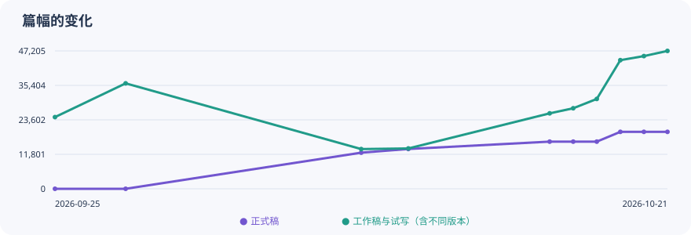
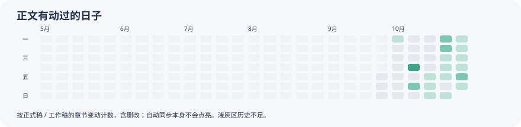

# 小说生长记录

写嗨了可能会失联，但故事还在慢慢长大。这里是自动更新的写作进度。

**最近统计：2026-10-31 21:00（北京时间）**  ·  通常每天 14:00 / 21:00 更新

> 统计更新时间表示程序完成同步，不代表作者当时在线。

| 内容 | 当前字数 | 今日净变化 | 近七天净变化 | 近七天日均 | 此前总日均（排除近七天） |
| :--- | ---: | ---: | ---: | ---: | ---: |
| 正式稿 | **35,633** | +7,333 | +16,123 | +2,303.3 | +672.8 |
| 工作稿与试写 | **87,196** | +6,641 | +39,736 | +5,676.6 | +790.2 |
| 大纲 | **388,625** | +7,663 | +343,800 | +49,114.3 | -2,992.3 |
| 设定 | **711,308** | -13,545 | +599,487 | +85,641.0 | +3,825.1 |

日均单位为字/天，按净增减计算。近七天包含今天，以七个自然日为分母；此前总日均从首个历史快照之后算起，截止近七天开始前一天，未增字的日期也计入。历史不足时不估算，显示“历史不足”。

## 正式稿阅读

[下载当前正式稿 TXT](https://github.com/JizhiShiroppu/novel-progress/releases/tag/latest-formal)

作品仍在连载。每卷合并为一个 TXT，文件名标明卷号与已收录章节范围；第0章为序章。

正式稿与工作稿分开计算；工作稿包含试写和不同版本，不能相加当作全书字数。

## 章节篇幅

| 章节编号 | 正式稿字数 | 工作稿与试写字数 | 工作稿份数 |
| :--- | ---: | ---: | ---: |
| 第1卷 · 序章 | 666 | 0 | 0 |
| 第1卷 · 第1章 | 10,728 | 11,562 | 1 |
| 第1卷 · 第2章 | 8,116 | 22,082 | 4 |
| 第1卷 · 第3章 | 8,790 | 36,376 | 3 |
| 第1卷 · 第4章 | 7,333 | 17,176 | 2 |

## 怎么读这些数字

- 字数按汉字、其他语言字母和数字逐字符计数，排除空白、标点、Markdown 标记、标题、代码块和注释；与写作软件可能略有差异。正文中保留的批注仍可能计入。
- 只统计正式稿、工作稿与试写、大纲、本作设定；目录说明、模板、弃稿、原作与二创参考资料、工程记录不计入。
- 曲线按已有 Git 快照回算；同一天取最后一个快照。没有快照的日期无法还原，线段仅连接已有记录。文件移动或整理也可能形成变动。
- 日历按正式稿与工作稿发生变化的章节数着色，改稿净增为零也可能点亮；并不区分作者与协作工具的修改，也不衡量写作时长。
- 看板只展示汇总数字、章节编号和统计时间；作者授权公开的正式稿另见 Releases。工作稿、设定内容与私人版本记录不公开。
- 电脑关机、休眠、未登录或断网可能导致延迟；页面停更不代表作者没有写作。
